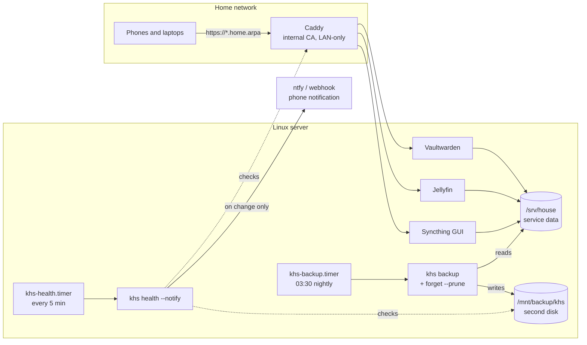

# kassar-house-server

**The setup and tooling for a self-hosted home server: services behind one HTTPS reverse proxy on the LAN, and `khs`, a small tool for deduplicated backups, restores, health checks and alerts.**


[](https://github.com/kassarahmad/kassar-house-server/actions/workflows/ci.yml)

## Why

A home server is easy to start and easy to lose: one dead disk and the passwords, photos and
synced files are gone, and nobody notices a full disk or a stopped container until something
breaks. This repository is the part that makes it dependable: backups that are verified and can
actually be restored, checks that tell you when something changes, and a service stack that is
reachable from home but not from the internet.

## What's in it

| Part | What it does | How it's verified |
| --- | --- | --- |
| [`khs/`](khs) | **Backups**: content-addressed, deduplicated, compressed snapshots on a second disk; retention (last/daily/weekly/monthly/yearly); `check` (with full re-hash); safe `restore` with owners, modes, times and symlinks | 56 tests; mutation-checked; benchmarked below |
| | **Health**: HTTP, TCP, disk, systemd unit, temperature, memory and *backup age* checks; ntfy or JSON webhook alerts **only when a state changes** | Tests against a real local HTTP server, sockets and `/proc` `/sys` fixtures |
| | **Report**: CPU, memory, swap, disks and temperatures from `/proc` and `/sys` | Fixture tests + the real machine |
| [`stack/`](stack) | Caddy (internal CA, LAN-only), Vaultwarden, Jellyfin, Syncthing | `docker compose config` here; CI also pulls every image and validates the Caddyfile |
| [`systemd/`](systemd) | Nightly backup + retention, health checks every 5 minutes, both sandboxed | `systemd-analyze verify` |
| [`provision/setup.sh`](provision/setup.sh) | Installs `khs` and the timers; `--harden` adds ufw (LAN only), key-only SSH and automatic security updates | 7 tests with a scratch root and recorded commands; shellcheck in CI |

No third-party Python packages: `khs` uses only the standard library, so it runs on a stock Debian or Raspberry Pi OS.

## Architecture



### How the backup repository works

```
/mnt/backup/khs/
  config.json              format, chunk size (4 MiB)
  objects/ab/abcd…         file chunks named by their SHA-256, zlib-compressed when it helps
  snapshots/<id>.json      one manifest per snapshot: paths, modes, owners, times, chunk lists
```

- **Deduplication**: a chunk is stored once no matter how many files or snapshots use it. Files whose size, mtime, ctime and inode haven't changed reuse the previous snapshot's chunks without being read.
- **Crash safety**: chunks and manifests are written to a temp file and renamed; the manifest is written last, so an interrupted backup leaves no snapshot, only unreferenced chunks that `prune` removes.
- **Integrity**: `khs check` confirms every referenced chunk exists; `--read-data` re-hashes each one and names the damaged snapshots.
- **Restore safety**: manifest paths can't escape the target (`..`, absolute paths), directories are created one component at a time refusing symlinks, files are opened with `O_NOFOLLOW`, symlinks are created last, and existing files are kept unless `--overwrite`.
- **Locking**: `flock` stops a backup and a prune from ever running on the same repository at once.

## Install

Requirements: Debian 12 / Ubuntu 22.04+ (or Raspberry Pi OS), Python 3.11+, Docker with Compose v2 for the stack, and a second disk mounted at `/mnt/backup`.

```bash
git clone https://github.com/kassarahmad/kassar-house-server.git
cd kassar-house-server
sudo provision/setup.sh --dry-run                     # see what it would do
sudo provision/setup.sh                               # khs, /etc/khs/khs.toml, timers
sudo provision/setup.sh --harden 192.168.1.0/24       # optional: ufw, key-only SSH, auto updates
```

Then edit `/etc/khs/khs.toml` (an annotated example is in [`etc/khs.example.toml`](etc/khs.example.toml)) and:

```bash
sudo khs config-check
sudo khs init /mnt/backup/khs
sudo systemctl start khs-backup.service && journalctl -u khs-backup -n 20
```

### The service stack

```bash
cd stack
cp .env.example .env        # LAN_IP, DATA_DIR, MEDIA_DIR...
docker compose up -d
docker compose ps
```

Point `home.arpa`, `vault.home.arpa`, `media.home.arpa` and `sync.home.arpa` at the server in your router's DNS (or each device's hosts file), then trust Caddy's root certificate on your devices: see [docs/RUNBOOK.md](docs/RUNBOOK.md).

## Using `khs`

```bash
khs backup                                  # snapshot the configured sources
khs snapshots                               # list them
khs restore latest --target /tmp/r          # full restore into a scratch directory
khs restore 20261014T0330 --target / --include srv/house/vaultwarden --overwrite
khs check --read-data                       # verify everything (slow on big repositories)
khs forget --keep-daily 7 --keep-weekly 4 --prune --dry-run
khs health                                  # OK / FAIL / ?? per check; exit 1 if anything fails
khs report                                  # CPU, memory, disks, temperatures
```

Exit codes: `0` ok, `1` error or failing check, `2` usage, `3` backup finished but some files were skipped (listed on stderr).

## Tests

```bash
python3 -m unittest discover -s tests -t . -v        # as a normal user
sudo python3 -m unittest tests.test_backup -v        # adds the ownership and capability tests
```

56 tests, standard library only. Highlights:

- round trips that compare content hashes, modes, mtimes, owners and symlinks of the source and restored trees
- deduplication (identical files, unchanged files not re-read, one changed chunk → one new chunk), and an edit that keeps size and mtime still detected
- interrupted backup leaves no snapshot; `check` finds missing and corrupt chunks and names the snapshot
- restore refuses `../`, absolute paths and symlinks planted in the target
- retention by day, ISO week, month and year, in local time; prune never deletes a chunk a kept snapshot uses
- health checks against a real HTTP server and sockets; notifications only on change, retried if sending fails
- the backup run with **only** `CAP_DAC_READ_SEARCH`, exactly as the systemd unit allows (needs root and `setpriv`)
- `setup.sh`: idempotent, dry-run changes nothing, SSH lockdown skipped without a key and rolled back if `sshd -t` fails

Mutation checks during development: disabling the symlink guard, the `..` check, the lock, prune's reference check, change detection or the notify-on-change logic each makes at least one test fail.

### Measured

On the build VM (2 vCPU), backing up `/usr/lib/python3.13` (1,250 files, 49 MiB):

| Step | Result |
| --- | --- |
| First backup | 2.9 s, 16.6 MiB stored after compression |
| Second backup, nothing changed | 0.12 s, 0 bytes read |
| `check --read-data` | 0.4 s |
| Full restore | 0.6 s, identical to the source (`diff -r`) |

## Security

- **Nothing is exposed to the internet.** Caddy answers `403` to non-private addresses, and published ports are bound to the server's LAN address, because Docker-published ports bypass ufw. For access away from home, use a VPN (WireGuard or Tailscale), not port forwarding.
- **No container gets the Docker socket**, host networking or new privileges; Caddy drops all capabilities except binding ports 80/443.
- **Vaultwarden**: sign-ups off, admin page disabled until you set an argon2 `ADMIN_TOKEN`.
- **systemd sandboxing**: the backup runs with `ProtectSystem=strict`, can write only to the repository and `/var/lib/khs`, keeps only `CAP_DAC_READ_SEARCH` and has no network; the health check has no capabilities at all.
- **Secrets**: `.env` and the notification token file are never committed (`.gitignore`); the config file is installed with mode `0600`.
- **Backups are not encrypted** by `khs`. Put the repository on an encrypted disk (LUKS) if the disk can leave the house.

## Limitations

- Tested here: `khs`, `setup.sh` (against a scratch root) and the static validity of the stack and units. **Not yet run end to end on real home hardware**: the containers, Caddy certificates and timers have only been validated, not exercised (registries were unreachable from the build environment; CI pulls the images).
- Fixed-size chunks: inserting data in the middle of a large file re-stores the chunks after the insertion point (content-defined chunking would avoid that).
- No encryption and no remote (off-site) target yet; copy the repository off-site with `rsync` or `rclone` in the meantime.
- Linux only (`/proc`, `/sys`, `flock`, systemd).

## Roadmap

- Off-site copy (`khs sync` to an rclone remote) and authenticated encryption.
- Content-defined chunking.
- Restore drills on a schedule: restore a random file and compare its hash.
- Prometheus text output for `khs report`.

## Troubleshooting

| Symptom | Likely cause |
| --- | --- |
| `khs-backup.service` fails with *dependency failed* | `/mnt/backup` isn't mounted (by design, so a missing USB disk can't fill the root disk) |
| `another khs command is using this repository` | a backup or prune is running; `systemctl status khs-backup` |
| Browser warns about the certificate | Caddy's root CA isn't installed on that device (RUNBOOK) |
| `sync.home.arpa` says *Host check error* | the `header_up Host` line was removed from the Caddyfile |
| Exit code 3 after a backup | some files were skipped (sockets, permission errors); they're listed in the journal |

## License

[MIT](LICENSE).
